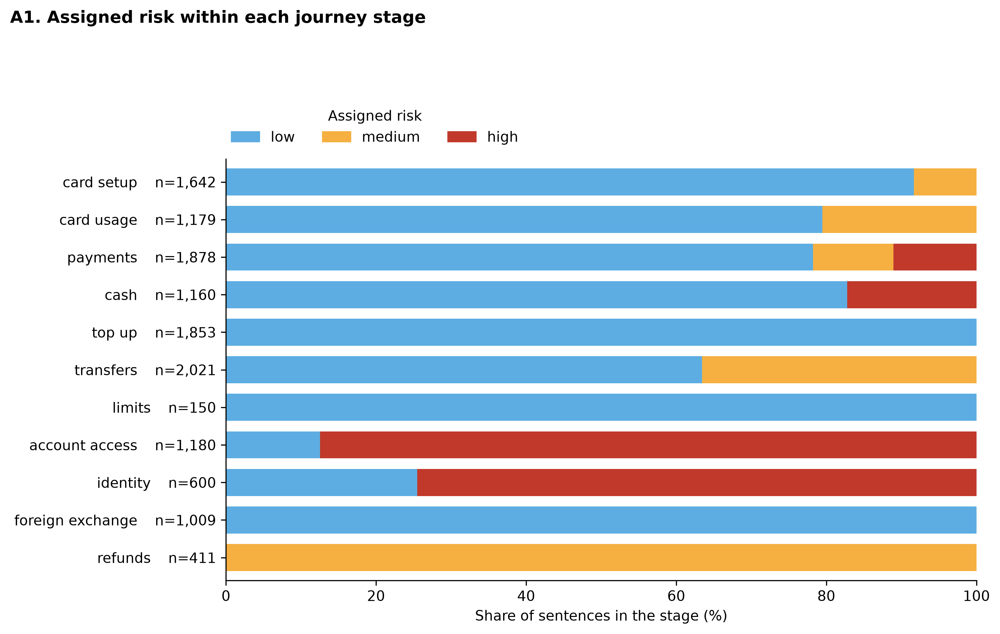
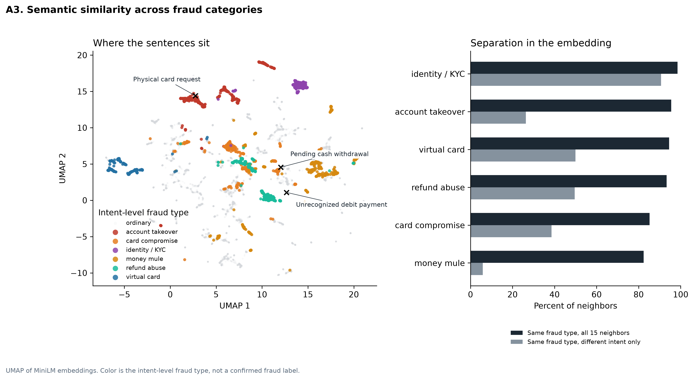
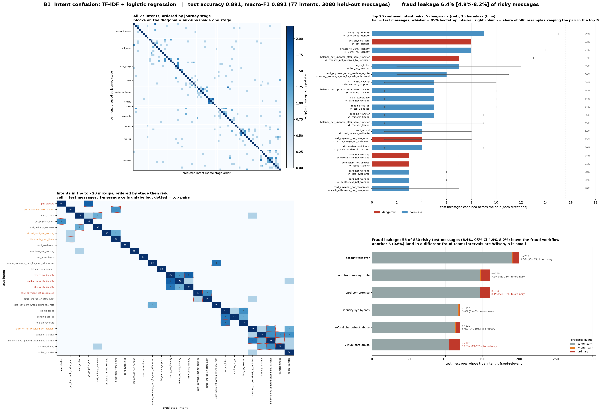
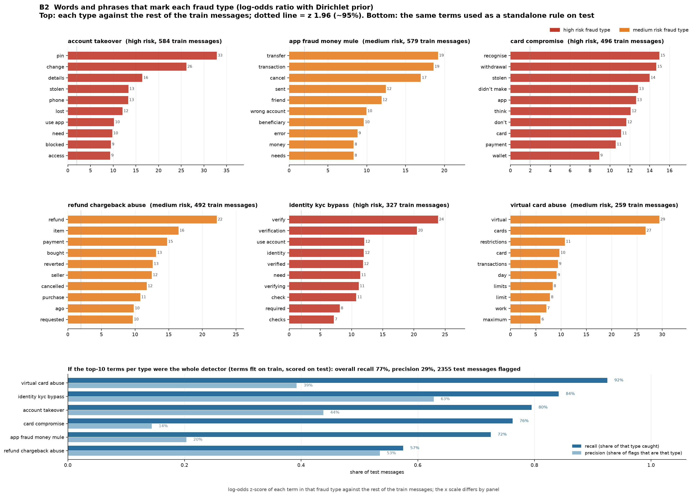
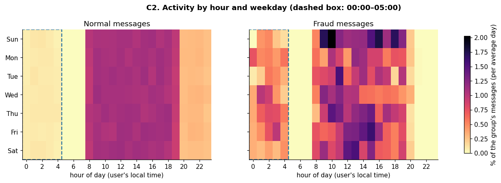
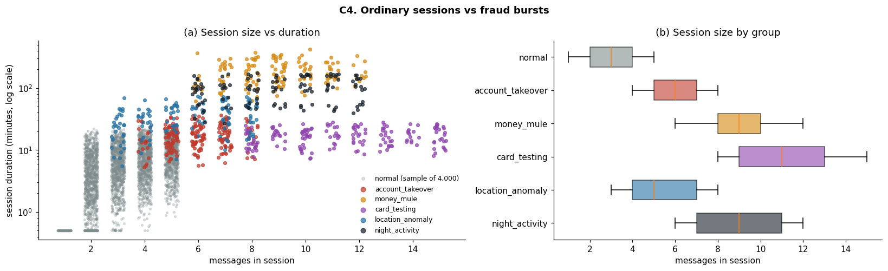

# Introduction and Background {#sec-introduction}

## Problem and motivation

Bank chatbots receive questions about payments, account access, transfers, and
other services. Similar wording can occur in a routine request, a compromised
account, or a conversation with a customer experiencing a scam. A useful review
system therefore needs to consider both what a message says and the surrounding
activity. This project develops the data and modeling workflow for that task.

## Research question

**How much does user behavior add to fraud detection beyond message text alone?**

We investigate message intent and describe temporal, session, sequence, and geographic patterns in the simulated stream.

## Background and label definitions

The source is [PolyAI's Banking77 dataset](https://huggingface.co/datasets/PolyAI/banking77),
used here following the [course final-project framework](https://jjacobs.me/dsan6000/final-project/).
Banking77 is an intent-classification dataset, not a collection of verified fraud
cases. We distinguish three labels throughout the report:

- **Intent:** the customer request category supplied by Banking77.
- **Assigned risk and fraud type:** our intent-level taxonomy for organizing review queues.
- **Simulated fraud:** the message-level `is_fraud` flag assigned by the stream generator.

An intent such as an unrecognized card payment can be relevant to fraud review
without proving that its author is committing fraud.

# Data Sources and Pipeline {#sec-data}

## Banking77 source data

Banking77 contains 13,083 English customer messages: 10,003 training examples and
3,080 test examples across 77 intents. Each source row contains text and an
intent label; observed user identities, session histories, times, cities, and
fraud outcomes are absent. The dataset card lists a CC BY 4.0 license.

## ETL and intent catalog

The preparation script validates source columns and split sizes, copies the
input files, collapses whitespace, trims text, and rejects empty cleaned
messages. It attaches intent names and preserves the original split, producing
`banking77_clean.parquet` with text, label, intent, split, and text length.

A second table, `dim_intent.parquet`, contains one row per intent, including
journey stage, assigned risk, fraud relevance, validity dates, and intent-set
version. The taxonomy organizes 77 intents into 11 journey stages and marks
22 intents as fraud-relevant across six taxonomy groups. These groups differ
from the five behavioral patterns introduced by simulation.

## Simulated message stream

The generator uses seed 7 and samples wording from the **training split**. It
adds users, sessions, timestamps, cities, and behavioral fraud flags. Approximately
30% of messages retain a manual intent label; the remaining messages enter an
unlabeled scoring population. Eight percent of users are assigned a fraud persona,
but only their designated fraud bursts receive a fraud flag.

| Profile | Messages | Users | Date window | Use |
|---|---:|---:|---|---|
| Development | 500,000 | 10,000 | October 2026 | Stream EDA and saved local intent scoring |
| Full | 50,000,000 | 1,000,000 | November 2025–October 2026 | Recorded S3/Spark cluster processing |

The five patterns are account takeover, money mule, card testing, location
anomaly, and night activity. Ordinary sessions also include occasional nighttime
activity, travel, and sensitive intents, so those individual attributes are not
exclusive fraud indicators. Messages are written in chunks partitioned by date.

## Storage and processing pipeline

Local preparation produces cleaned source tables and simulated Parquet files.
The executed cluster notebook reads the simulated stream from Amazon S3, compacts
its daily partitions, and writes intermediate session tables and small summaries
back to storage. This demonstrates an S3 processing path even though the existing
upload helper and central storage configuration remain placeholders; they are
not a complete automated deployment workflow.

The ETL implementation is in `src/data/prepare_banking77.py` and
`src/data/simulate_stream.py`, with parameters in `config/`.

# System Architecture {#sec-architecture}

## End-to-end architecture

| Stage | Input | Processing | Output |
|---|---|---|---|
| Preparation | Banking77 train/test files | Validate, clean, attach intent taxonomy | Clean messages and intent catalog |
| Simulation | Training sentences and configuration | Generate users, sessions, locations, fraud bursts | Date-partitioned message stream |
| Cluster analytics | Parquet data in S3 | Spark compaction, aggregations, windows, session grouping | Compacted messages and summaries |
| Intent modeling | Clean train/test splits and unlabeled stream | TF-IDF and logistic regression | Intent predictions and test metrics |
| Reporting | Small saved tables and figures | Interpret and present results | HTML manuscript |

The saved cluster analytics run and local intent-model run are separate execution
paths. Full-stream distributed fraud-model training is not demonstrated.

## Cluster configuration

The cluster notebook runs from an EC2 master using a three-worker standalone
Spark cluster. Its recorded default parallelism is six cores. Configuration sets
48 SQL shuffle partitions, 4 GB executor memory, 2 GB driver memory, and the
Hadoop AWS package for S3 access.

{#fig-executors}

## Partitioning and intermediate tables

The full stream initially contains 18,250 Parquet files. Repartitioning by date
and rewriting the stream produces 365 files, with an assertion checking that the
50-million-row count is unchanged. Per-user `lag` windows calculate message gaps;
session grouping produces message counts, durations, and city counts. Only small
aggregate tables are collected into pandas for reporting.

## Reproducibility

The repository stores simulation settings, notebooks, output CSV files, and
cluster screenshots. This manuscript references those existing artifacts and
has execution disabled, so rendering does not launch simulation or Spark jobs.

# Exploratory Data Analysis {#sec-eda}

## Intent structure and semantic overlap

Part A examines the original 13,083 messages. Assigned risk is concentrated in
account-access and identity intents: 87.5% of account-access sentences and 74.5%
of identity sentences are assigned high risk. These proportions describe the
chosen taxonomy, not the prevalence of fraud in banking conversations.

{#fig-stage-risk}

The semantic map uses MiniLM sentence embeddings and UMAP. The original embedding
space, rather than the two-dimensional plot, supplies the nearest-neighbor
measurements. Identity-related wording remains cohesive across different intents,
whereas apparent account-takeover cohesion is driven largely by neighbors of the
same intent. This cautions against interpreting visual separation as a detector.

{#fig-semantic-map}

Median message lengths are 46 characters for low risk, 50 for medium risk, and
45 for high risk. Length alone provides little descriptive separation.

## Text features and intent confusion

Part B fits a TF-IDF/logistic-regression intent baseline and examines its errors.
Its held-out accuracy is 89.06%. Among 880 test messages assigned fraud-relevant
intents, the analysis reports 56 routed to ordinary servicing categories. This
is taxonomy-based routing error, not a count of confirmed fraud cases missed.

{#fig-confusion}

A keyword rule constructed from training text retrieves 678 of 880
fraud-relevant test messages: 77.05% recall with 28.79% precision. It flags 2,355
messages in total, illustrating the false-alert burden of treating characteristic
words as standalone detection rules. Urgency analysis also finds that incident
words such as references to theft are more informative for some taxonomy groups
than generic time-pressure language.

{#fig-keywords}

{#fig-urgency}

## Temporal and session behavior

Parts C and D visualize the development stream. Their patterns reflect the
simulation rules. Ordinary sessions typically contain three messages and last
six minutes. Development-stream card-testing sessions have a median of eleven
messages over seventeen minutes; money-mule sessions span much longer intervals.
These are descriptive contrasts rather than measured predictive performance.

{#fig-hour-weekday}

{#fig-sessions}

The full-stream Spark analysis supports similar descriptive comparisons. Its
median within-session message gap is 115 seconds for ordinary messages,
64 seconds for card testing, and 143 seconds for account takeover. Message speed
therefore does not isolate every simulated fraud pattern.

## Intent sequences and geography

Part D examines adjacent intent transitions within sessions, distance from the
user's simulated home city, and intent co-occurrence. Account-takeover sequences
move from account-access topics toward transfers by construction. Location-anomaly
bursts occur away from home, but ordinary trips also occur away from home, so
distance alone is not equivalent to fraud.

For descriptive sequence analysis, missing intent labels are recovered through
text lookup against the source catalog after consistency checks. This is not a
demonstration of model accuracy on unseen wording.

{#fig-sequences}

{#fig-distance}

{#fig-cooccurrence}

## Implications for modeling

The analyses motivate combining text with session size, duration, recent message
gaps, intent transitions, and location history. They also reveal shortcuts a
model might exploit. In the saved full-stream persona summary, location-anomaly
users average about 23 messages while normal users average about 50; background
volume therefore remains a potential confound. These features require evaluation
on held-out users or time periods before they can support detection claims.

# Natural Language Processing {#sec-nlp}

## Text preparation and TF-IDF

The scikit-learn baseline uses unigram/bigram TF-IDF with sublinear term frequency,
Unicode accent stripping, and a minimum document frequency of two. The vectorizer
is fitted on the original training split and transforms the held-out test split.

The Spark pipeline lowercases and tokenizes text, constructs bigrams, fits separate
unigram and bigram count vocabularies with minimum document frequency two, applies
IDF weights, and assembles the vectors. Its feature construction and regularization
settings differ from the scikit-learn pipeline; the reported scores are separate
baseline results rather than an isolated comparison of execution engines.

## Sentence embeddings and semantic analysis

Part A uses
[`all-MiniLM-L6-v2`](https://huggingface.co/sentence-transformers/all-MiniLM-L6-v2)
to represent each message as a normalized 384-dimensional vector. Fifteen cosine
nearest neighbors characterize semantic overlap, including an analysis excluding
neighbors with the same intent. UMAP uses cosine distance, fifteen neighbors,
minimum distance 0.1, and random seed 7 for visualization. These embeddings support
EDA; they have not been evaluated as features in the planned fraud comparison.

## Intent matching and extensions

# Machine Learning {#sec-ml}

## Tasks and evaluation design

The completed supervised task predicts one of 77 intents using the original
10,003/3,080 train/test split. The proposed fraud task instead predicts simulated
`is_fraud`. Intent accuracy cannot substitute for fraud precision or recall.
Repeated training sentences in the simulated stream also mean that scoring this
stream is an operational demonstration rather than an independent generalization
benchmark.

## Intent classifiers

The scikit-learn model is logistic regression with `C=10`, up to 2,000 iterations,
and random state 42. The Spark MLlib model is multinomial logistic regression with
`regParam=0.01`, no elastic-net mixing, and up to 100 iterations. Its model is saved
and reloaded before scoring unlabeled messages. Predictions include the assigned
intent, taxonomy risk, probability-based confidence, and a review flag when
confidence is below 0.5. That threshold is a review heuristic, not a calibrated
fraud threshold.

The saved Spark intent notebook runs with `ON_CLUSTER=False`. It trains on the
original Banking77 training split, not on the stream's manually labeled subset;
the stream is subsequently divided into labeled and unlabeled tables for scoring.

## Text-only and text-plus-behavior fraud models

# Results {#sec-results}

## Intent classification

| Model | Test messages | Accuracy | Weighted F1 |
|---|---:|---:|---:|
| scikit-learn TF-IDF + logistic regression | 3,080 | 89.06% | 89.08% |
| Spark MLlib TF-IDF + logistic regression | 3,080 | 84.45% | 84.49% |

Source: `eda/output/b1_metrics.json` and `spark/output/intent_test_metrics.csv`.
The Spark result additionally reports 85.17% weighted precision and 84.45%
weighted recall. Differences in pipeline settings prevent attributing the score
gap to distributed processing alone.

## Unlabeled stream scoring

The saved local Spark run scores 350,036 unlabeled development-stream messages.
Mean reported confidence is 0.938; 0.90% of predictions fall below the review
threshold, and 9.97% receive an intent assigned medium or high risk. These are
prediction summaries, not fraud prevalence estimates or held-out accuracy.
The recorded training time is 49.1 seconds and scoring/write time is 9.3 seconds.

Source: `spark/output/intent_scoring_summary.csv` and `intent_timings.csv`.

## Contribution of behavior to fraud detection

## Full-stream distributed processing

The saved S3/Spark run processes 50 million messages, one million users, and
14,709,922 sessions across 365 days. Manual intent coverage is 30%, and the rounded
simulated fraud-message rate is 1.29%.

| Operation | Recorded time (seconds) |
|---|---:|
| Count raw stream | 319.8 |
| Compact daily files and rewrite user data | 560.9 |
| Count compacted stream | 10.0 |
| Full-stream overview | 32.7 |
| Daily aggregation | 13.0 |
| Message-gap quantiles using windows | 52.1 |
| Write session table | 74.5 |
| Summarize session table | 12.5 |

Source: `spark/output/timings.csv`, `run_summary.csv`, and `C1_overview.csv`.
Compaction reduces file count from 18,250 to 365 while preserving row count.
The recorded counts differ by a factor of about 32, but caching, metadata access,
and run order are not controlled, so this is not a general speedup benchmark.

## Full-stream session summaries

| Message/session group | Sessions | Median messages | Median duration (minutes) |
|---|---:|---:|---:|
| Ordinary | 14,629,922 | 3 | 6.0 |
| Account takeover | 19,927 | 6 | 16.7 |
| Money mule | 16,116 | 9 | 180.4 |
| Card testing | 16,127 | 11 | 16.4 |
| Location anomaly | 15,962 | 5 | 34.7 |
| Night activity | 11,868 | 9 | 95.9 |

Source: `spark/output/C4_session_summary.csv`. These groups describe ordinary
sessions and flagged bursts, rather than assigning every session from a fraud
persona to fraud.

## Scope of performance evidence

The repository demonstrates full-scale distributed analytics and a separate
local intent-model run. It does not provide controlled scaling experiments,
full-stream cluster intent inference, or measured single-machine memory failure.

# Discussion and Conclusion {#sec-discussion}

## What the current results establish

Text models classify Banking77 intent with useful held-out accuracy, while the
routing and keyword analyses identify overlap between ordinary and fraud-relevant
wording. Spark processes the larger simulated stream and extracts compact
behavioral summaries. These results establish the analysis foundation; they do
not yet establish how much behavior adds to fraud detection.

## Limitations and validity

Fraud labels are assigned by generator rules. Learning those rules successfully
would not demonstrate performance on real bank fraud. User histories, cities,
and times are synthetic; city-center distances are not verified impossible
travel. Repeated source sentences limit linguistic diversity. Taxonomy-assigned
risk differs from simulated message-level fraud, and false-alert rates measured
against one definition should not be described using the other.

Some background-volume differences and time-window restrictions could provide
artificial model shortcuts. The development EDA and full-scale analytics also
cover different date windows and populations; their numbers should not be mixed.
Probability confidence is not calibrated, and the review threshold has not been
validated against review capacity or monetary costs.

## Future work

## Conclusion

The project has implemented data cleaning, a reproducible simulated message
stream, text and behavioral EDA, intent classifiers, and S3/Spark processing of
50 million messages. The strongest completed predictive result is 89.06% intent
accuracy on the held-out Banking77 test split.

# References {.unnumbered #sec-references}

- PolyAI. [Banking77 dataset and dataset card](https://huggingface.co/datasets/PolyAI/banking77).
- DSAN 6000. [Final Project: Datasets and Timeline](https://jjacobs.me/dsan6000/final-project/).
- Sentence Transformers. [all-MiniLM-L6-v2 model card](https://huggingface.co/sentence-transformers/all-MiniLM-L6-v2).
- Project repository. [Scalable Fraud Detection in Banking Chatbot Conversations](https://github.com/MingyangHan-1021/DSAN6000-Project).

The implementation details and numerical results in this draft come from the
repository's scripts, executed notebooks, and saved tables identified above.
